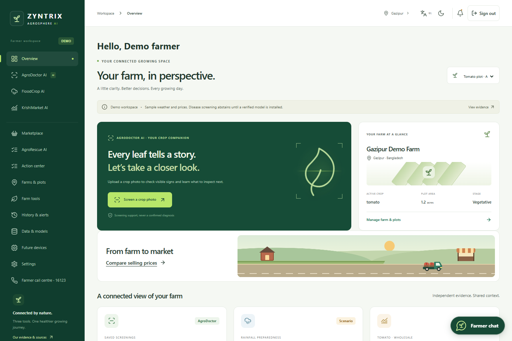
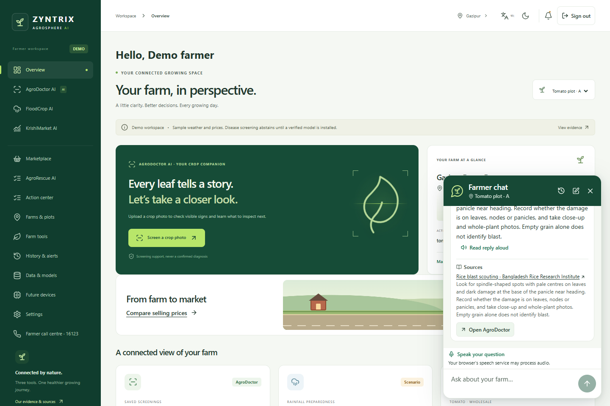
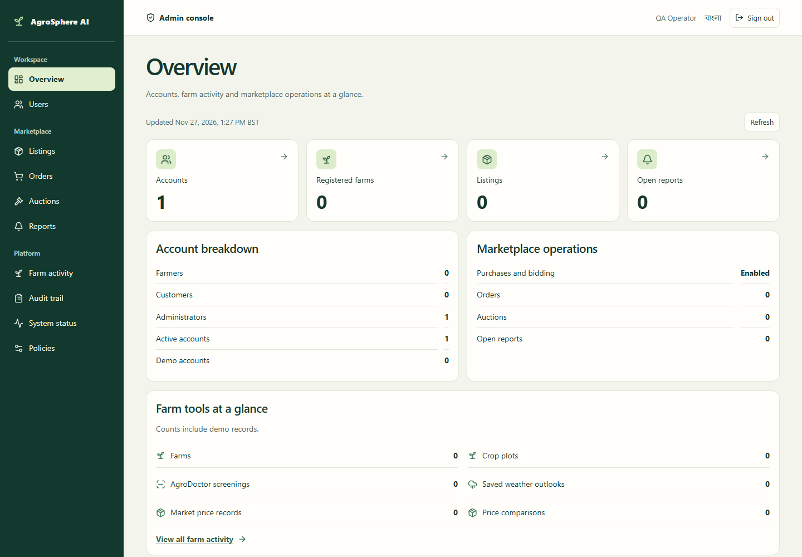

# ZYNTRIX AgroSphere AI

AgroSphere is a bilingual farm workspace for Bangladesh. Farmers can screen crop photos, prepare for heavy rain, compare selling options and manage their farm records in English or Bangla.



## What you can do

| Feature | What it does |
| --- | --- |
| **AgroDoctor AI** | Screen leaf and produce photos, review visible signs and uncertainty, save a case and compare a second view. [Model setup and limits](docs/agrodoctor-multicrop.md) |
| **FloodCrop AI** | Check rainfall for a farm with consented coordinates, review drainage or waterlogging preparedness, and follow official flood information links. [Set a farm location](docs/area-selection.md) |
| **KrishiMarket and AgroRescue** | Compare buyer offers after costs, browse fixed-price produce and optional auctions, and save harvest selling scenarios. Checkout records are for demo pickup or cash on delivery. [Marketplace](docs/marketplace.md) · [Harvest planner](docs/agrorescue.md) |
| **Farmer Chat** | Ask questions in English, Bangla or common Banglish. The chat retrieves 34 bilingual guidance passages, can answer through Groq, and can show relevant published guidance during provider faults. Voice input depends on browser support. [Retrieval and sources](docs/farmer-chat-rag.md) |
| **Farm tools** | Review crop calendars, reminders, expenses, storage batches and community crop reports. The offline notebook supports selected saved records. [Farm tools](docs/farm-tools-plan.md) |
| **Admin console** | Manage account status, seller verification, listings, orders, auctions, reports and marketplace policies. Review the audit trail, aggregate farm activity and model availability. [Admin provisioning](docs/marketplace.md#roles-and-authentication) |

## Screenshots

**Farmer Chat** showing a rice-blast scouting reference from the Bangladesh Rice Research Institute.



**Admin console** showing account counts, marketplace operations and farm activity in an isolated demo.



## Run locally

Use Python 3.12 or 3.13 and Node.js 22 or 24 with npm. Docker builds use Python 3.12 and Node.js 24. The native example below uses PowerShell and SQLite.

```powershell
git clone https://github.com/ShishiMaru81/AI-BUILDERS-.git
cd AI-BUILDERS-
if (-not (Test-Path .env)) { Copy-Item .env.example .env }
python -m venv .venv
.\.venv\Scripts\python.exe -m pip install -r apps/api/requirements.txt
cd apps/api
..\..\.venv\Scripts\python.exe -m alembic upgrade head
..\..\.venv\Scripts\python.exe -m uvicorn app.main:app --host 127.0.0.1 --port 8000
```

In a second terminal, start from the repository root.

```powershell
cd apps/web
npm ci
$env:NEXT_PUBLIC_API_URL = 'http://127.0.0.1:8000/api/v1'
npm run dev
```

Open the English or Bangla workspace and select **Explore a demo farm**. The API health endpoint confirms that the server is running. The readiness endpoint also checks the database, media storage and installed model bundles. [English workspace](http://127.0.0.1:3000/en) · [Bangla workspace](http://127.0.0.1:3000/bn) · [API reference](http://127.0.0.1:8000/docs) · [API health](http://127.0.0.1:8000/api/v1/health)

### Configure optional services

| Setting | When you need it |
| --- | --- |
| `SIGNUP_DATA_KEY` | Password sign-up with encrypted identity details and photos. Generate a Fernet key once with `python -c "from cryptography.fernet import Fernet; print(Fernet.generate_key().decode())"` in the API environment. Keep it stable and private. |
| `GROQ_API_KEY` | Hosted vision screening and generated Farmer Chat answers. Keep it in the backend environment. The bundled guidance still works when the API is reachable and Groq is unavailable. |
| `DATABASE_URL` | Use your own PostgreSQL database or a separate SQLite database. Run Alembic against the selected database before starting the API. |
| `CORS_ORIGINS` | Allow the exact web origin when changing host names or ports. Use comma-separated origins. |
| `NEXT_PUBLIC_API_URL` | Set the web environment to the backend address ending in `/api/v1` before starting or building Next.js. |

Mail and SMS provider setup is separate from the password and demo flows. All credentials belong in private environment settings. [Backend environment template](.env.example) · [Email configuration](docs/email-setup.md)

### Provision an administrator

Run this from `apps/api` with the same database settings as the API. Use a fresh email for the admin account. The command prompts for the password in the terminal.

```powershell
..\..\.venv\Scripts\python.exe -m app.market_admin create-admin --email admin@example.com --name Operator
```

On the sign-up page, select **Admin sign in**. The API verifies the administrator role before serving any console data. Regular sign-up creates only farmer or customer accounts. The console summarizes farm activity as counts, with private photos, conversations and identity documents protected by the existing account boundaries. [Local admin sign-in](http://127.0.0.1:3000/en/admin) · [Account roles and operations](docs/marketplace.md#roles-and-authentication)

### Install local AgroDoctor models

Run these commands from the project root using the virtual environment created above. The installer downloads pinned artifacts and verifies their checksums.

```powershell
.\.venv\Scripts\python.exe -m pip install -r apps/api/requirements-ml.txt --index-url https://download.pytorch.org/whl/cpu
.\.venv\Scripts\python.exe -m pip install -r ml/doctor/requirements-export.txt
.\.venv\Scripts\python.exe scripts/install_doctor_models.py
```

Restart the API after installation. The built-in bundles cover supported leaves. Groq supports leaf and produce screening, and locally trained tomato/potato leaf and produce models can be enabled as research previews through `AGRODOCTOR_RESEARCH_MODEL_DIR` and `AGRODOCTOR_RESEARCH_PRODUCE_MODEL_DIR`. Keep downloaded datasets, generated bundles, training checkpoints and private field photos outside the tracked project files. [Model catalog and configuration](docs/agrodoctor-multicrop.md) · [Kaggle workflow](docs/agrodoctor-kaggle-quickstart.md) · [Leaf and produce research](docs/agrodoctor-leaf-and-produce-followup.md)

### Use Docker and PostgreSQL

Install the local bundles above first so the Compose API readiness check can load the configured models. From the repository root, run:

```powershell
docker compose up -d --build
docker compose ps
```

Compose starts PostgreSQL, the FastAPI service, Next.js and the marketplace lifecycle worker. The stack keeps PostgreSQL and image data in named volumes. Defaults are web port `3100`, API port `8100` and PostgreSQL port `55432`. Use `WEB_PORT`, `API_PORT` and `DB_PORT` for local overrides. Existing SQLite data requires a separate migration. [Docker website](http://127.0.0.1:3100/en) · [Docker API reference](http://127.0.0.1:8100/docs)

## Hosting

- **Vercel preview.** Import `apps/web` with the Next.js preset and set `NEXT_PUBLIC_DEPLOYMENT_TIER=frontend_preview` for a website preview while the API is unavailable.
- **Vercel app with API.** Import `apps/api` as a separate FastAPI project, connect PostgreSQL, set `HOSTING_TIER=vercel_demo` and `DATA_MODE=DEMO`, and allow the frontend's exact origin in `CORS_ORIGINS`. On the web project set `NEXT_PUBLIC_DEPLOYMENT_TIER=vercel_demo` and `NEXT_PUBLIC_API_URL` to the public API address ending in `/api/v1`. The hosted build uses temporary photo storage and relies on Groq for hosted inference. Enable hosted password signup through `ENABLE_HOSTED_ACCOUNTS=1` and a persistent private `SIGNUP_DATA_KEY` when that flow is needed.
- **Netlify.** The root `netlify.toml` configures the frontend. Use a separate public HTTPS API and database for accounts and farm tools. [Netlify backend setup](docs/netlify-deployment.md)

## Repository and verification

| Path | Contents |
| --- | --- |
| `apps/web` | Next.js and React interface, unit tests and Playwright workflows |
| `apps/api` | FastAPI routes, SQLAlchemy models, migrations and API tests |
| `ml/doctor` | AgroDoctor dataset preparation, training, notebooks and evaluation |
| `data/agrodoctor` | Attribution, source audits and field intake templates |
| `docs` | Implementation notes, operations and evaluation evidence |

```powershell
# Repository root
.\.venv\Scripts\python.exe -m pytest -q ml/doctor/tests ml/doctor/test_prepare_kaggle_dataset.py
# apps/api
..\..\.venv\Scripts\python.exe -m pytest -q
# apps/web
npm run typecheck
npm test
npm run build
npm run test:e2e -- admin-console.spec.ts farmer-chat.spec.ts
```

Start both services before Playwright checks. Windows defaults to Microsoft Edge. To use installed Playwright Chromium, set `PLAYWRIGHT_CHANNEL=chromium`. CI can use the included workflow template. [CI template](docs/ci-workflow.yml) · [Architecture](docs/architecture.md) · [Current verification and limits](docs/status.md) · [Read-only MCP tools](docs/agrosphere-mcp.md)

## How to interpret the results

AgroDoctor results are screening suggestions. The research evaluations use held-out photos and still need independent, expert-reviewed validation on Bangladesh farms. FloodCrop shows rainfall preparedness rather than plot inundation probability. Marketplace pages label synthetic records, recorded quotes and user-entered selling assumptions. [Evaluation evidence](docs/evidence.md) · [Local model cards](docs/model_card.md) · [Photo credits and licenses](docs/crop-images.md)
